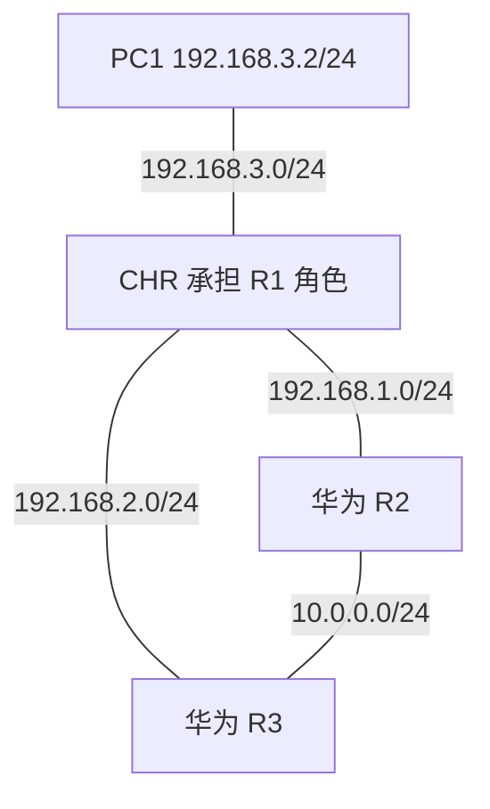

# GNS3 ACL 包过滤实验

高小雅 · 20243001297 · 2026 年 10 月 17 日

本项目记录网络安全课程中三项访问控制策略的设计、实现和验证。实验运行于 Windows 11 + WSL2 Ubuntu + GNS3 + QEMU/KVM 环境，使用 MikroTik CHR 承担 R1 的路由与过滤角色，华为 CE12800 作为 R2、R3，VPCS 作为 PC1。

## 实验结果

通过 ICMP 和 TCP 端口探测，结合防火墙计数验证三项过滤策略。PC1 到 192.168.2.2 的普通 ICMP 对照获得 5 次回复。

| 规则 | 过滤条件 | 累计丢弃 |
|---|---|---:|
| ACL1 | 10.0.0.0/24 → 192.168.3.0/24，所有 IP 报文 | 5 包，420 B |
| ACL2-WEB | 192.168.3.0/24 → 10.0.0.0/24，TCP 80 | 15 包，900 B |
| ACL3-FTP | 192.168.3.0/24 → 其他子网，TCP 21 | 30 包，1800 B |

Web 和 FTP 部分采用 TCP 目的端口探测。表中为观察时的累计报文数，包含连接重传。

## 报告与实验记录

- [Word 实验报告](report/Lab2_ACL_Report.docx) · [在线正文](docs/report.md)
- [实验环境](docs/environment.md) · [拓扑与接口对应](docs/topology.md)
- [验证记录](docs/verification.md) · [排障过程](docs/troubleshooting.md)
- [复现步骤](docs/reproduction.md) · [材料索引](docs/evidence-index.md)
- [参考资料](docs/references.md)

## 核心拓扑

CHR 沿用原 R1 的三个接口地址，R2、R3 与 PC1 的地址规划保持不变。旧 R1 已停止；test1、test2 为排障辅助设备。

## 实施与排障要点

- 核对 CE12800 模板的界面标签与设备内部接口名称，修正两位编号偏移。
- 结合 VPCS 对照、ARP 和宿主机 UDP 抓包定位通信问题。
- 在 GNS3 内替换 R1 角色，通过 CHR 的 forward 链实现三项过滤。
- 用规则丢弃计数与允许流量对照分析测试结果。

## 文件目录

| 目录 | 内容 |
|---|---|
| `report/` | Word 实验报告 |
| `docs/` | 在线报告、环境、验证与排障说明 |
| `configs/` | 根据执行记录整理的复现配置 |
| `evidence/terminal/` | 按测试编号整理的终端输出摘录 |
| `evidence/original-text/` | 上传的原始文本附件 |
| `evidence/screenshots/` | 实验截图 |
| `topology/` | 逻辑拓扑图与 Mermaid 源文件 |
| `scripts/` | 附件哈希检查脚本 |

材料来源和文件名对照见 [材料索引](docs/evidence-index.md)。设备镜像不随仓库分发。
