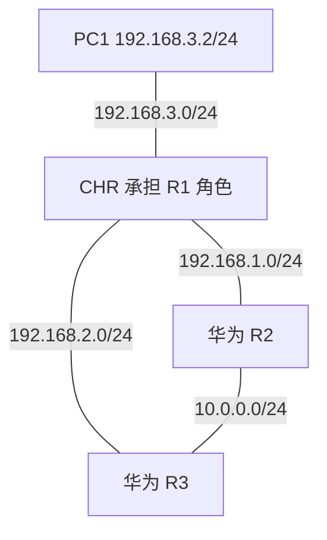
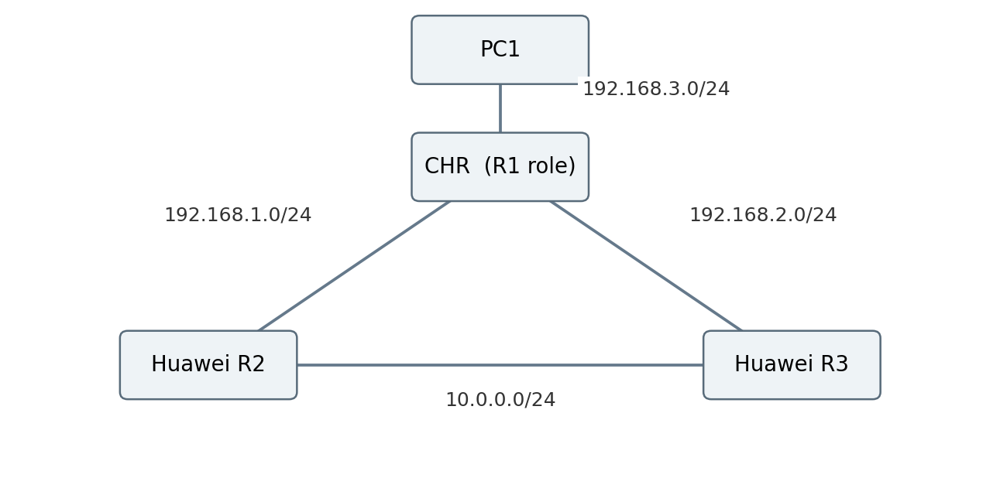

# 核心拓扑与接口对应

旧 CE12800 R1 停止，CHR 承担它的逻辑角色。接入 PC1、R2 和 R3 的地址没有改变，因此原有下一跳规划得以保留。

| CHR 在 GNS3 中的标签 | RouterOS 内部名称 | 对端 GNS3 标签 | 对端内部名称 |
|---|---|---|---|
| Ethernet0 | ether1 | R2 GE1/0/2 | R2 GE1/0/0 |
| Ethernet1 | ether2 | R3 GE1/0/2 | R3 GE1/0/0 |
| Ethernet2 | ether3 | PC1 Ethernet0 | PC1 Ethernet0 |

R2—R3 连线保留，GNS3 标签两端为 GE1/0/3，内部均为 GE1/0/1。

本次 CE12800 模板实测的标签映射为：GE1/0/2 → 内部 GE1/0/0、GE1/0/3 → 内部 GE1/0/1、GE1/0/4 → 内部 GE1/0/2。此规律仅适用于本实验模板，不推广为所有设备的规则。

现有截图 `image(20261017-131727).png` 记录的是 CHR 接线选择阶段，并非最终完整拓扑。最终 GNS3 界面截图仍可由实验者补充到本目录。
